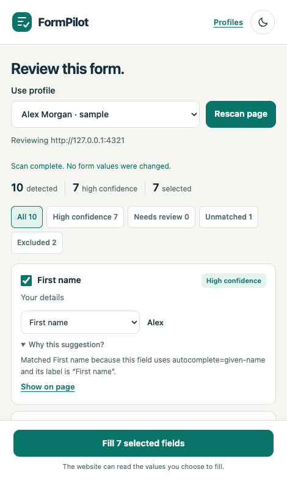

# FormPilot

**Fill the familiar. Review the uncertain.**

A local-first browser extension for reusing your own details across repetitive forms. Save personal and work profiles, explicitly inspect a page, review explained suggestions, select fields and fill them—without submitting the form.

**Your details. Your device. Every form, reviewed by you.**

Built by [Faizal Imam](https://github.com/faizalimam00) · [Repository](https://github.com/faizalimam00/FORM-PILOT) · [Documentation](https://github.com/faizalimam00/FORM-PILOT/tree/main/docs) · [Report a bug](https://github.com/faizalimam00/FORM-PILOT/issues)



Version 0.1 is a local, unpacked Chromium release. No account, subscription, backend, analytics or paid AI API. Matching is deterministic semantic matching. The source is available at [faizalimam00/FORM-PILOT](https://github.com/faizalimam00/FORM-PILOT). The website runs locally; no hosted demo or browser-store listing is available yet.

## Install the prebuilt download

The prebuilt package is `dist/releases/formpilot-0.1.0-chrome.zip`. A shared copy can be installed directly. After starting the local website, its [download page](http://127.0.0.1:4321/install/) serves the same archive. For repository visitors, [CI runs](https://github.com/faizalimam00/FORM-PILOT/actions/workflows/ci.yml) will offer the `formpilot-browser-downloads` artifact after a successful run of the packaging workflow; if no artifact is available, use the source-build steps below. No Node.js, npm or source compilation is required for the downloaded package.

1. Extract the ZIP into a permanent folder, such as `Documents/FormPilot`.
2. Open `chrome://extensions`, enable **Developer mode**, then choose **Load unpacked**.
3. Select the extracted folder containing `manifest.json`, pin FormPilot and save a profile.

The same Chromium package is intended for Edge (`edge://extensions`) and Brave (`brave://extensions`), but these browsers have not been independently tested here. Firefox, Safari and mobile browsers are unsupported. This is a manual installation, not a store listing or one-click installer. See the [official Chrome installation steps](https://developer.chrome.com/docs/extensions/get-started/tutorial/hello-world#load-unpacked).

`dist/releases/` includes installation instructions, a SHA-256 checksum and release metadata. The ZIP contains only compiled extension files, license notices and instructions; no saved profiles or local settings. To update, replace files in the **same extracted folder**, click Reload in browser settings, and refresh the form tab. Export a profile backup before updating; a different folder can create a different extension identity.

## Try it locally

Prerequisites: Node **22.22.x or 24 LTS**, npm **10+**, and a desktop Chromium browser. The project includes a pinned local Node runtime for reproducible npm scripts. Use a supported host Node release for installation.

```sh
git clone https://github.com/faizalimam00/FORM-PILOT.git
cd FORM-PILOT
npm ci
npm run build
npm run dev
```

Open **http://127.0.0.1:4321/demo/** for the interactive playground. It uses the actual matcher on fictional, controlled form data; it cannot inspect other tabs.

Standalone extension demos:

- [Event registration](http://127.0.0.1:4321/forms/event/): names, contact details and organization.
- [Job application](http://127.0.0.1:4321/forms/job/): professional links, bio and unfamiliar labels.
- [Shipping details](http://127.0.0.1:4321/forms/shipping/): two address sections, country/state selects and dynamic replacements.
- [SaaS onboarding](http://127.0.0.1:4321/forms/saas/): React-controlled fields and conditional company details.
- [Difficult form](http://127.0.0.1:4321/forms/difficult/): ambiguous labels, existing values and deliberate exclusions. Abstention is a successful outcome.

## Load the extension

1. Run `npm run build`.
2. Open `chrome://extensions`, enable **Developer mode**, choose **Load unpacked**.
3. Select **`apps/extension/.output/chrome-mv3/`** and pin FormPilot.
4. Open profile settings. Create a profile or **Try a fictional sample**, then save.
5. Visit a standalone demo form. Click FormPilot → **Review this page** → **Scan page**.
6. Review the proposed values and reasons, select fields, and choose **Fill selected fields**.

Keep the review window open while checking the form. Undo is available for the last fill for five minutes, skips subsequent edits, and is cleared on rescan. FormPilot never submits or advances a form.

## What works

- Separate named personal and work profiles, explicit active selection, custom nonsensitive fields and derived/overridden full name.
- Versioned JSON export, validated import preview, explicit merge/replace, individual and all-data deletion.
- Autocomplete, explicit/wrapping labels, accessibility metadata, normalized aliases, type compatibility and section context.
- High confidence, needs review and no reliable match, with explanations and warnings. These are not probabilities.
- Per-field corrections, explicit selection, filters, page highlighting and honest fill outcomes.
- Nonempty values protected by default; replacement requires opt-in and selection.
- Live-element/session validation, React input/change handling and guarded undo.
- Opt-in corrections remembered for an exact origin and matching form/field/section; inspect and delete them in settings.
- Light/dark interfaces, reduced-motion support and compact review layout.

## Supported controls and limits

V1 targets desktop Chromium with a declared API minimum of Chrome 120. Automated browser verification uses the exact version in [QA_REPORT.md](docs/QA_REPORT.md); the minimum version is not a broad compatibility certification.

Supported: native text, email, telephone and URL inputs, textareas and single native selects, in the top-level document. Multiple forms and dynamic controls require review/rescanning. Fill country first and rescan before filling a newly rendered state control.

Excluded: hidden/disabled/read-only fields, passwords, OTP, payment and suspected sensitive fields, file uploads, CAPTCHA, checkboxes/radio buttons, consent, agreements, submit controls, number/date inputs and multiple selects. Unsupported: all iframes, open/closed shadow roots, rich-text editors and custom dropdowns. Labels/aliases are primarily English; country/region aliases are a documented subset. No universal compatibility claim.

Scans are bounded to 500 controls and 1,000 options per select. Use one review window per target tab. Protected browser/store pages cannot be scanned. See the [website limitations source](apps/website/src/pages/limitations.md).

## Privacy model

Profiles use **extension-local storage**, never cloud sync. FormPilot does not encrypt that storage or protect against someone with device access. Complete profiles stay in trusted extension contexts. The injected script receives only selected values for filling, and temporarily holds original values for change detection and undo.

The destination website can read filled values **before submission**. Export files contain readable personal information. Delete exported files separately when no longer needed. No runtime matching calls, analytics or remote executable code are included.

Permissions are limited to `activeTab`, `scripting` and `storage`; there are no persistent host permissions. Read the [privacy policy](apps/website/src/pages/privacy.md), [permission rationale](docs/architecture/README.md) and [threat model](docs/architecture/threat-model.md).

## Architecture

```text
apps/extension       WXT MV3 launcher, review window, profile options, isolated detector
apps/website         Astro static site, docs, articles, React demos and playground
packages/profile-schema   Versioned Zod schemas and profile operations
packages/matching-engine  Pure deterministic matching, exclusions and normalization
packages/dom-adapter      Detection, safe fill and guarded undo
packages/form-fixtures    Five demos, development cases and fixed evaluation set
packages/ui               Shared visual system and review controls
tests/integration         DOM, storage boundary and domain behavior
tests/extension           Packaged-extension Chromium and website browser tests
```

The review surface is a persistent window, so it stays available while you inspect the page without requiring a side-panel API. [Architecture details](docs/architecture/README.md).

The monorepo uses **npm workspaces** and one authoritative lockfile, `package-lock.json`. React 19, WXT 0.21, Astro 7, Tailwind 4, Zod 4, TypeScript strict, Vitest 5 and Playwright are pinned by that lockfile. Use `npm ci` for a reproducible installation.

## Measured benchmark

```sh
npm run benchmark
```

There are 156 synthetic English metadata cases: 56 development examples and a separately authored fixed 100-case evaluation set. Results include precision, eligible-field coverage, abstention, high-confidence errors, scenario breakdown and median/p95 runtime with environment details.

The measured 2026-10-16 run produced **98.3% precision** (58/59 proposals), **72.8% coverage** of 81 eligible fields, **27.2% abstention**, and **zero incorrect high-confidence matches**. All 21 intentional abstentions and 19 exclusions were handled as expected. Median matcher time was **0.0093 ms**, p95 **0.0153 ms** on Apple M1 Pro / Node 22.22; this excludes DOM and browser work. One review-level proposal was incorrect.

See the **[actual generated results](docs/benchmarks/results.md)** and [denominator definitions and limitations](docs/benchmarks/methodology.md). The JSON includes every error; initial results are retained separately. These examples do not represent all websites. The browser suite separately tests fill behavior and DOM changes.

## Development and checks

```sh
npm run dev                 # Website at 127.0.0.1:4321
npm run dev:extension       # WXT development browser
npm run start               # Preview built static site
npm run lint
npm run typecheck
npm test                    # Unit + DOM integration tests
npm run benchmark
npm run build
npm run test:browsers       # Install Playwright Chromium
npm run test:e2e            # Real extension and website browser tests
npm run format:check
npm run check               # Lint + types + unit/integration + builds
npm run package:extension   # Build the shareable ZIP, instructions and checksum
```

Tests load the unchanged production manifest in a persistent Chromium context and trigger its actual toolbar action through Chromium’s extension debugging protocol. They do not grant all-site access or substitute playground checks for extension tests. `.env.test.local` can set `FORMPILOT_CHROMIUM_PATH` to an existing supported Chromium executable; it is ignored by Git. Default CI uses Playwright’s bundled browser.

`npm run build` generates the extension package before building the website, so `/install/` serves a working download. Generated packages live in `dist/releases/` and `apps/website/public/downloads/` (ignored by Git), and are copied into the static site output. CI retains the tested download bundle as a workflow artifact without publishing a GitHub release. A browser test downloads the ZIP, verifies its checksum and production-file contents, then loads the extracted package and performs a real reviewed fill.

For genuine captures, run a built website preview, then `npm run capture`. Captures use only the fictional sample. `docs/assets/capture-info.json` records their provenance. Automated accessibility checks complement responsive screenshots; they are not a full manual assistive-technology audit.

## Website configuration and release

Copy `.env.example` to `.env` and set only the values you actually own:

- `PUBLIC_SITE_URL`: real HTTPS deployment origin, without a path.
- `PUBLIC_GITHUB_USERNAME`: defaults to `faizalimam00`.
- `PUBLIC_REPOSITORY_URL`: defaults to `https://github.com/faizalimam00/FORM-PILOT`.
- `PUBLIC_DOCS_URL`: `https://github.com/faizalimam00/FORM-PILOT/tree/main/docs` for shared documentation links.

Without a domain, the website omits canonical/absolute social URLs and sitemap, emits noindex and disallows crawling. A configured build generates canonical URLs, Open Graph metadata, sitemap and robots from that origin. No live domain is invented. Deploy `apps/website/dist/` to a static host only when authorized. See [deployment checklist](docs/launch/deployment.md).

## Roadmap and contributing

The next useful work is independently contributed fictional form cases, broader international aliases, additional framework fixtures and carefully tested support for more controls. Firefox, embedded frames and custom dropdowns require separate design and permission review. LLM-assisted matching is only a future experiment, with explicit privacy, latency, cost and evaluation requirements; it is not in this product.

Read [CONTRIBUTING.md](CONTRIBUTING.md), [SECURITY.md](SECURITY.md), and [CODE_OF_CONDUCT.md](CODE_OF_CONDUCT.md). Small reproducible cases are more helpful than broad compatibility claims. Never put personal exports in an issue.

Created by **[Faizal Imam](https://github.com/faizalimam00)**, a software developer and AI builder who enjoys creating useful tools and exploring practical engineering problems. Follow [@faizalimam00](https://github.com/faizalimam00) for project updates and engineering notes. A profile README draft and an unpublished 30-day launch plan live in [docs/launch](docs/launch/).

[MIT license](LICENSE) · [Changelog](CHANGELOG.md) · [Verification report](docs/QA_REPORT.md)
