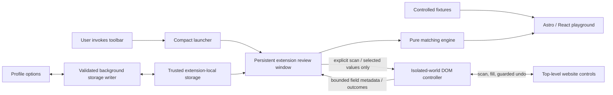

# Architecture

FormPilot 0.1 is a local-first, deterministic, review-before-fill extension and a static demonstration website. There is no backend, authentication, subscription, analytics or remote matching service.

## Packages and boundaries

- `profile-schema`: strict Zod models, schema v1 imports/exports, 20-profile and 30-custom-field limits, validation, derived full name and fictional sample.
- `matching-engine`: no browser or React dependency. Types, aliases, sensitive-field exclusions, confidence categories, explanations, exact-scope remembered mappings and conservative select normalization.
- `dom-adapter`: isolated document scanner and mutation controller. Shared by the injected extension bundle and controlled website playground. No storage, profile or networking API.
- `form-fixtures`: five scenario definitions, development examples and a separate fixed evaluation file.
- `ui`: shared visual tokens, semantic controls, review rows and explicit selection behavior.
- `extension`: WXT MV3 launcher, unlisted review page, options, background storage writer and injected unlisted detector script.
- `website`: Astro static routes with React islands only where interaction helps. Documentation and articles remain crawlable HTML.

## Why a review window

A toolbar popup closes when focus moves to a form. A standalone 470 × 840 review window retains the session while the user checks the page. It avoids requiring a side-panel API. Its target tab ID is fixed by the launcher. It never silently switches to whichever tab becomes active. Open a fresh review from another tab’s toolbar action when changing destinations. Use one review window per target tab.

## Permissions

| Permission  | Purpose                                             | Boundary                                                |
| ----------- | --------------------------------------------------- | ------------------------------------------------------- |
| `activeTab` | Temporary access to the tab the user invoked        | User gesture; cross-origin navigation revokes access    |
| `scripting` | Inject bundled detector after Scan page             | Top frame, isolated world, no persistent content script |
| `storage`   | Profiles and remembered mappings in `storage.local` | Access level set to `TRUSTED_CONTEXTS`; no sync         |

No `tabs` permission, persistent host permissions, external connections, web-accessible resources or remote scripts. Windows creation and querying nonsensitive tab attributes do not require the `tabs` permission. The review requires the temporary grant to read the target URL and inject.

## Detection and identity

The scanner reads at most 500 native controls in DOM order. Each receives a random UUID token bound to a live element reference in a document-local Map. Tokens are not injected into page attributes. A semantic fingerprint includes path, form ID/name/action/method/heading, control tag/type/ID/name, autocomplete, labels, accessibility text, placeholder, section and options. It excludes entered values. Eligible original values remain in the isolated controller for change detection; excluded control values are never read. A completed fill discards these scan snapshots, retaining only changed values in the undo batch. Another fill requires a rescan.

Fill requests carry session UUID, token, chosen value and explicit replacement flag. Before each mutation the controller checks session/URL, connection, current exclusions, semantic fingerprint, original value, dropdown compatibility and maxlength. DOM positions are never the sole identity. A native prototype value setter dispatches bubbling input/change events. There is an event-loop yield between fields so React can update dependent controls. A replaced state dropdown is treated as stale; the user rescans.

The short event-loop check detects immediate rejections. A website can make a later asynchronous change, so users still inspect the final form. No extension can guarantee arbitrary application behavior from input events alone.

## Review and uncertainty

Autocomplete and exact-scope memories take priority over weak metadata. Incompatible types are rejected. Strong conflicting labels abstain; an autocomplete conflict yields a visible review warning. Company-email wording is classified as email. Bare name/account/team name labels abstain. Billing/shipping and other-person contexts require review. Duplicate fingerprints suppress memory reuse and automatic selection.

No heuristic number is presented as a probability. Empty profile values have no fill selection. Manual remapping deselects the field until reviewed. A nonempty field requires explicit replacement permission and explicit selection.

## Storage and consistency

Background messages only accept same-extension trusted pages, not content-script senders. Strict schemas validate message payloads and stored state. The service worker serializes writes and checks a monotonically increasing revision, preventing silent overwrite from concurrent options windows. A conflict asks the user to reload, preserving the unsaved editor.

Exports contain profiles and active selection, not memories. Merge updates identical profile IDs and adds new ones; replace replaces the profile collection. Mappings survive profile replacement and fall back if their property no longer exists. All-data deletion clears storage and notifies open reviews to discard temporary state.

## Undo and lifecycle

The most recent fill stores only changed elements, prior values, written values, fingerprint and an edit revision. Undo requires the same live control/fingerprint, the written value and unchanged event revision. Later input/change events cause a skip even if the value was changed away and back. Silent programmatic edits returning to the exact same value cannot be detected; document this limit.

Undo expires after five minutes. Scan data expires after 15 minutes. A new scan, closing review, document pagehide or reinjection clears the controller. A new fill replaces the undo batch. Timers can be delayed in suspended tabs. In-memory cleanup is not cryptographic erasure.

## Build and deployment

Node 22.22.x or 24 LTS, npm workspaces, TypeScript strict, React 19, WXT 0.21, Astro 7, Tailwind 4, Zod 4, Vitest 5 and Playwright. The initially considered older Astro/Vitest releases had security advisories; patched versions are used. The only stack substitution is npm for pnpm because this execution environment permitted npm’s registry access and blocked pnpm’s. `package-lock.json` is authoritative; `npm ci` is the clean install path.

The pinned local Node development dependency makes npm scripts use Node 22.22 even when the shell has an older Node. Contributors should still install a supported host Node release. Website CLI telemetry is disabled in every npm script. No telemetry is present in the product.

Build artifacts are local. Hosting requires a real domain in PUBLIC_SITE_URL. Without it, canonical/absolute social links and sitemap are omitted and robots blocks indexing. Deployment and public account configuration are separate explicit maintainer actions.
